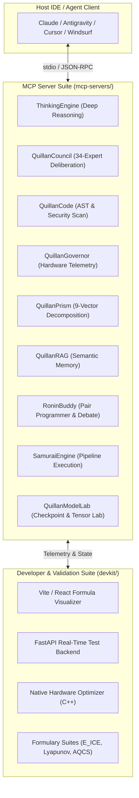

# ⚔️ Quillan-Ronin: MCP + DevKit
### Sovereign Model Context Protocol Servers, Developer Tooling & Mathematical Validation Suite

[](https://github.com/leeex1/Quillan-Ronin)
[](https://modelcontextprotocol.io)
[](LICENSE)

A unified repository combining the complete **Quillan-Ronin Model Context Protocol (MCP) Server Suite** and the **Developer Validation Test Kit (DevKit)**. 

Engineered by **CrashOverrideX**, this repository equips AI agents (Antigravity IDE, Claude Desktop, Cursor, Windsurf, Replit) and software engineers with deep reasoning engines, adversarial code auditors, swarm orchestration hooks, hardware resource governors, and real-time mathematical formula validation dashboards.

---

## 🏛️ System Architecture



---

## 📦 What's Inside

### 1. Model Context Protocol (MCP) Servers (`mcp-servers/`)
Ten specialized, high-performance MCP servers operating over stdio JSON-RPC:

| MCP Server | Runtime | Primary Tools Exposed | Core Purpose |
| :--- | :---: | :--- | :--- |
| **`quillan_thinking_engine`** | Python | `quillan_think`, `council_deliberate`, `prism_decompose`, `deep_reasoning`, `genius_level` | Multi-phase wave cognitive reasoning and adversarial debate |
| **`quillan_council`** | Python | `council_predator_strike`, `council_cluster_deliberate`, `council_pull_weights` | 34-expert HNMoE council orchestration & consensus arbitration |
| **`quillan_code`** | Python | `codeweaver_ast_inspect`, `codeweaver_security_scan`, `codeweaver_refactor_adviser` | AST-level code analysis, vulnerability hunts, and refactoring |
| **`quillan_governor`** | Python | `governor_system_telemetry`, `governor_thread_budget`, `governor_velocity_tune` | CPU/GPU budgeting, token velocity control, and RAM calculators |
| **`quillan_prism`** | Python | `prism_decompose`, `prism_threat_model`, `prism_bushido_gate` | 9-Vector semantic decomposition and Bushidō covenant verification |
| **`quillan_rag`** | Python | `ingest_file`, `ingest_folder`, `search`, `ask`, `kb_stats` | Local vector memory, LanceDB search, and grounded retrieval |
| **`quillan_buddy`** | Python | `buddy_spawn_clone`, `buddy_spar`, `buddy_duo_debate`, `buddy_code_review` | Interactive pair programming companion and dialectic sparring |
| **`quillan_samurai_engine`** | Python | `samurai_full_pipeline`, `samurai_cycle_step`, `samurai_gate_check` | Full sovereign inference and lifecycle step execution |
| **`quillan_model_lab`** | Python | `model_checkpoint_inspect`, `model_dataset_validator`, `model_hardware_advisor` | Model weight verification, tensor diagnostics, and training telemetry |
| **`thinking-engine`** | Node.js | TypeScript thinking engine bridge | High-throughput async JSON-RPC cognitive dispatcher |

---

### 2. Developer & Validation Test Kit (`devkit/`)

* **Interactive Frontend Dashboard (`devkit/frontend/`)**: Vite + React + TypeScript visualizer for evaluating mathematical formulas, live hardware curves, and system telemetry in real time.
* **FastAPI Backend Server (`devkit/backend/`)**: High-speed evaluation harness executing benchmark gains, token entropy optimizations, and parity checks.
* **Native Hardware Optimizer (`devkit/native_monitor/`)**: Bare-metal C++17 telemetry monitor tracking CPU thread allocation, GPU VRAM saturation, and DWM priority preservation.
* **Formal Formula Suites**:
  * `quillanFormulas.ts`: E_ICE thermodynamic energy, Lyapunov stability bounds, AQCS wavefunction collapse.
  * `foundationFormulas.ts`: Information theory, entropy estimation, and Bayesian calibration.
  * `nextverseFormulas.ts`: Spatial 3D projections, physical kinematic modeling, and world simulation equations.

---

## 🚀 Quickstart & Setup

### Prerequisites
- Python 3.10+
- Node.js 18+ (for Vite dashboard & Node thinking engine)
- CMake & C++ Compiler (optional, for native hardware optimizer)

### 1. Installation

```bash
# Clone the repository
git clone https://github.com/leeex1/MCP-DevKit.git
cd MCP-DevKit

# Install Python dependencies for MCP servers & backend
pip install -r requirements.txt

# Install frontend DevKit dependencies
cd devkit/frontend
npm install
cd ../..
```

### 2. Running the DevKit Dashboard

```bash
# Start frontend visualizer
cd devkit/frontend
npm run dev

# Start backend test runner (in separate terminal)
cd devkit/backend
python main.py
```

Open `http://localhost:5173` in your browser to inspect real-time mathematical validation and hardware curves.

---

## 🔌 Connecting to Claude Desktop / Antigravity / Cursor

Add the servers to your client configuration file (`claude_desktop_config.json` or `mcp_config.json`):

```json
{
  "mcpServers": {
    "QuillanCode": {
      "command": "python",
      "args": ["/path/to/MCP-DevKit/mcp-servers/quillan_code/server.py"]
    },
    "QuillanThinking": {
      "command": "python",
      "args": ["/path/to/MCP-DevKit/mcp-servers/quillan_thinking_engine/server.py"]
    },
    "QuillanCouncil": {
      "command": "python",
      "args": ["/path/to/MCP-DevKit/mcp-servers/quillan_council/server.py"]
    },
    "QuillanGovernor": {
      "command": "python",
      "args": ["/path/to/MCP-DevKit/mcp-servers/quillan_governor/server.py"]
    },
    "QuillanPrism": {
      "command": "python",
      "args": ["/path/to/MCP-DevKit/mcp-servers/quillan_prism/server.py"]
    },
    "QuillanRAG": {
      "command": "python",
      "args": ["/path/to/MCP-DevKit/mcp-servers/quillan_rag/server.py"]
    }
  }
}
```

See [mcp_config.template.json](mcp_config.template.json) for a complete template with all 10 servers.

---

## 📜 License & Credits

- Architect: **CrashOverrideX**
- Ecosystem: [Quillan-Ronin](https://github.com/leeex1/Quillan-Ronin)
- License: [MIT](LICENSE)
